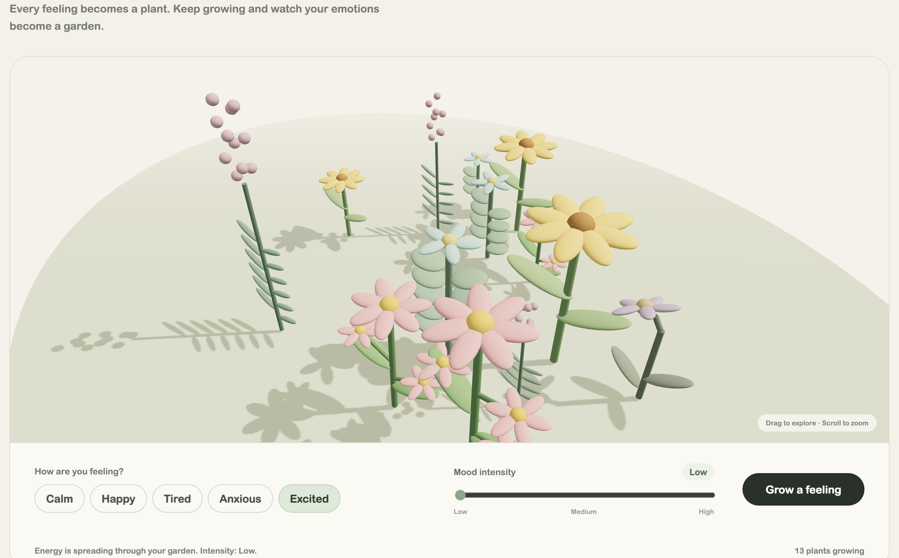

# Mood Garden

Mood Garden is a small interactive 3D web experience that turns emotions into plants.

The idea is simple: each feeling becomes a plant. Users choose how they feel, select how strong that feeling is, and grow a new plant inside a shared 3D garden. As more feelings are added, the garden gradually becomes a visual record of the user's emotional state.

Instead of presenting mood tracking as numbers or charts, Mood Garden represents emotions through different plant forms, colours, sizes, and movements.

## Target User

Mood Garden is designed for people who want a simple and playful way to reflect on how they are feeling.

The experience does not aim to provide psychological assessment or diagnosis. It is intended as a lightweight visual interaction that encourages users to notice and express their current emotions.

## Main Interaction

The interaction follows a simple sequence:

1. Choose a mood:
   - Calm
   - Happy
   - Tired
   - Anxious
   - Excited

2. Select how strong the feeling is:
   - Low
   - Medium
   - High

3. Click **Grow a feeling**.

4. A new procedural 3D plant grows inside the garden.

Each mood produces a different plant form. The selected intensity changes the scale and growth of the plant.

The garden keeps all previously generated plants, allowing individual feelings to accumulate into a larger visual garden.

Users can also drag the 3D scene to explore the garden from different angles.

## Interaction Feedback

The experience provides several forms of feedback:

- A plant grows immediately after the user presses the button.
- Different moods generate visually different plants.
- Plant size changes according to emotional intensity.
- A short message confirms which feeling has been added.
- A plant counter shows how many feelings are currently growing in the garden.
- The 3D scene can be rotated to inspect the plants from different viewpoints.

If the user clicks **Grow a feeling** without selecting a mood, the program displays a message asking them to choose a mood first.

## User Trial

A short user trial was conducted to observe how a first-time user understood the interaction.

The main interaction—choosing a mood and growing a plant—was understood quickly. However, the ability to rotate and explore the 3D garden was less immediately noticeable.

Based on this observation, the camera instruction was made more visible and changed to:

> ↔ Drag to explore the garden

The label **Mood intensity** was also changed to **How strong is this feeling?** to make the interface feel more natural and easier to understand.

## How to Run

Mood Garden uses Three.js ES modules, so the project should be opened through a local web server instead of opening `index.html` directly.

### 1. Download or clone the repository

Open the project folder in VS Code or another code editor.

### 2. Start a local server

In Terminal, navigate to the project folder and run:

```bash
python3 -m http.server 8000
```

### 3. Open the webpage

Open a browser and visit:

```text
http://localhost:8000
```

### 4. Stop the server

Return to Terminal and press:

```text
Control + C
```

## Project Structure

```text
mood-garden/
├── index.html
├── style.css
├── script.js
├── README.md
└── PROCESS.md
```

`index.html` contains the webpage structure and interaction controls.

`style.css` defines the visual interface and responsive layout.

`script.js` creates the Three.js scene, procedural plants, interaction logic, animation, lighting, camera controls, and feedback system.

## Technical Approach

The 3D garden is created entirely through code using Three.js.

No external 3D plant models are used. Plant components such as stems, leaves, flower centres, petals, and terrain are generated using Three.js geometry.

Each emotional state has its own plant-generation function. These functions change properties such as:

- plant height
- leaf arrangement
- flower structure
- number of branches
- colour
- movement speed
- overall posture

The plants are then positioned inside the shared garden scene.

## Known Limitations

The current version has several limitations:

- The garden only exists during the current browser session. Refreshing the page resets all plants.
- Plant positions are generated from a predefined set of available areas.
- The plant forms are stylised procedural representations rather than realistic botanical models.
- Some plant structures may appear slightly different depending on the camera angle.
- The experience currently includes five predefined moods.
- Emotional intensity is represented using only three levels: Low, Medium, and High.
- The project requires an internet connection to load Three.js from the CDN.

## Screenshot



## Credits

### Three.js

This project uses Three.js for real-time 3D rendering, lighting, geometry, animation, and camera interaction.

Three.js:  
https://threejs.org/

### AI Assistance

AI tools were used during the development process to support coding, debugging, and design exploration.

AI suggestions were not used without evaluation. Some suggestions were kept, while others were modified or rejected based on visual testing and interaction design decisions.

More details about the design process and AI usage are documented in `PROCESS.md`.

## Author

Ranran Zeng

PolyU SD5913  